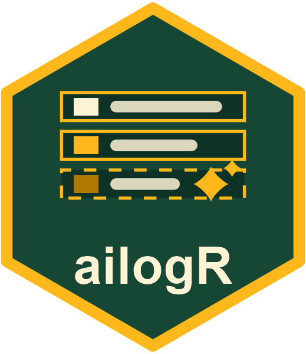

# ailogR 

ailogR logs AI use in research one task at a time, quickly enough to do at
the end of every work session. Each entry is a row in a plain CSV file in the
project's `ai-use/` folder.

- **Quick to use.** `log_ai()` asks up to six questions and lists your last
  tool and research stage first.
- **Detail where it matters.** Each entry records whether an error in the AI
  output would be `obvious`, `checkable` or `silent`. Silent ones need a
  check that could catch them.
- **AI tools can draft entries.** Coding agents and chat apps draft an entry
  at the end of a session; you review it with `edit_ai_log()`.
- **Checks and statements.** `check_ai_log()` finds gaps, and
  `draft_ai_statement()` drafts the AI-use statement for a paper.

## Install

```r
# install.packages("remotes")
remotes::install_github("CRASR/ailogR")
```

## Use

```r
library(ailogR)
create_ai_log()          # once per project: makes ai-use/
log_ai()                 # after each work session where AI output stayed in the work
edit_ai_log()            # fix an entry, or review one drafted by an AI tool
check_ai_log()           # find missing or invalid fields
draft_ai_statement()     # draft the AI-use statement
```

The vignettes cover each step:

- `vignette("ailogR")`: getting started.
- `vignette("what-to-log")`: when to log and how to choose error visibility.
- `vignette("ai-drafted-entries")`: setting up Claude Code, Copilot, or chat
  apps to draft entries.

## What to log

Log a use when its output stays in the work, or shaped a decision you
adopted, and an error in it could change your results or claims. This
follows Resnik and Hosseini (2025), who argue that disclosure of AI use
should be mandatory when the use is intentional and substantial.

How much to record depends on one question: **if the AI output were subtly
wrong, would that show?**

| Level | A wrong output would... | Examples |
|---|---|---|
| `obvious` | be visible to anyone reading all of it | Copy-editing, code comments, a translation you can read |
| `checkable` | fail, error, or look wrong | Plotting code, file import, functions with tests |
| `silent` | still run and look plausible | Joins, unit conversions, aggregations, model code, QA/QC rules |

`checkable` and `silent` entries also record how they were checked. The
levels are this package's convention. They build on the point that the
dangerous errors in scientific software are the ones that run and produce
plausible results (Soergel 2015).

## Research stages

`research_stage` uses the headings of the AID Framework (Weaver 2024), plus
`software` and `writing_original_draft` from CRediT, so log entries map onto
statements written in that format.

## CRASR's policy

ailogR is general. The [CRASR AI-use policy](https://github.com/CRASR/ai-use)
describes how CRASR uses AI; projects that follow it can say so in their
statement.

## References

- Resnik, D. B. & Hosseini, M. (2025). Disclosing artificial intelligence
  use in scientific research and publication: When should disclosure be
  mandatory, optional, or unnecessary? *Accountability in Research*.
  https://doi.org/10.1080/08989621.2025.2481949
- Soergel, D. A. W. (2015). Rampant software errors may undermine scientific
  results. *F1000Research* 3: 303. https://doi.org/10.12688/f1000research.5930.2
- Weaver, K. D. (2024). The Artificial Intelligence Disclosure (AID)
  Framework: An introduction. *College & Research Libraries News* 85(10):
  407–411. https://doi.org/10.5860/crln.85.10.407

## AI use in this package

This package was drafted with Claude; its own log is in [`ai-use/`](ai-use/).
